<p align="center">
  <a href="https://ilghar.studio">
    <picture>
      <source media="(prefers-color-scheme: dark)" srcset="docs/hero/hero-dark.svg">
      
    </picture>
  </a>
</p>

<p align="center"><b><a href="https://ilghar.studio">OPEN THE SITE</a></b></p>

# ilghar.studio

Personal landing — bilingual (EN/DE), light/dark, in-app readers for studio notes and documents.
By ilghar.studio. [Live site](https://ilghar.studio) · [GitHub Pages preview](https://ilghar.github.io/ilghar-studio/)

## My role
Creative Technologist & Spatial Designer

## What it shows
- **PDF palette:** Paper, mauve and pink title initial only — no off-palette leftovers on the landing.
- **Self-hosted type:** Jost and Vazirmatn under Pages CSP (`style-src` / `font-src` 'self').
- **Demos home:** SÁBÁT and P01 demos ship under `/demos/` for review.

## Preview card
- Title: ilghar.studio
- Label: Design systems
- One line: Personal landing for computational design work from Berlin.

## How it works
1. Open https://ilghar.studio
2. Pick a card: notes, CV, portfolio, pavilion, or a live demo
3. Light/dark follows system or the in-page control

```
npm run dev
```

## Process
- **Brief:** A bilingual portfolio home that matches the print PDF system.
- **Options tried:** Tailwind theme bridge; raw CSS tokens; mixed Google Fonts.
- **Rejected and why:** Google Fonts violate Pages CSP; off-palette hexes broke DESIGNER—BOSS review.
- **How it was tested:** Typecheck, CI, and visual Pages checks on the layout branch.

---
<sub>ilghar.studio</sub>
