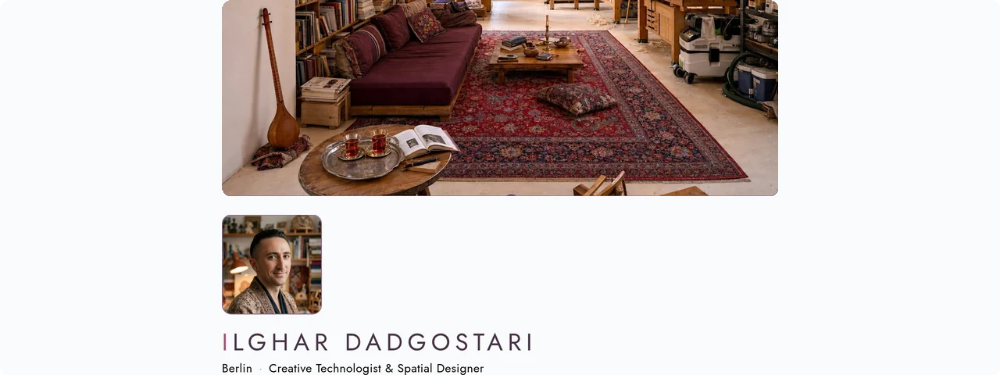

<p align="center">
  <a href="https://ilghar.studio">
    <picture>
      <source media="(prefers-color-scheme: dark)" srcset="docs/hero/hero-dark.webp">
      
    </picture>
  </a>
</p>

# ilghar.studio

A bilingual personal landing for computational design work from Berlin, with in-app readers for studio notes and documents.

Open the live site: [ilghar.studio](https://ilghar.studio) · GitHub Pages preview: [ilghar.github.io/ilghar-studio](https://ilghar.github.io/ilghar-studio/) · Repository: [Ilghar/ilghar-studio](https://github.com/Ilghar/ilghar-studio)

## How it's used

Open the site, switch language (EN/DE) or light and dark if you want, and pick a card: studio notes, CV, portfolio, or a live demo such as SÁBÁT or P01. The landing follows the system colour scheme and keeps a manual toggle.

```
npm run dev
```

[ilghar.studio](https://ilghar.studio)
